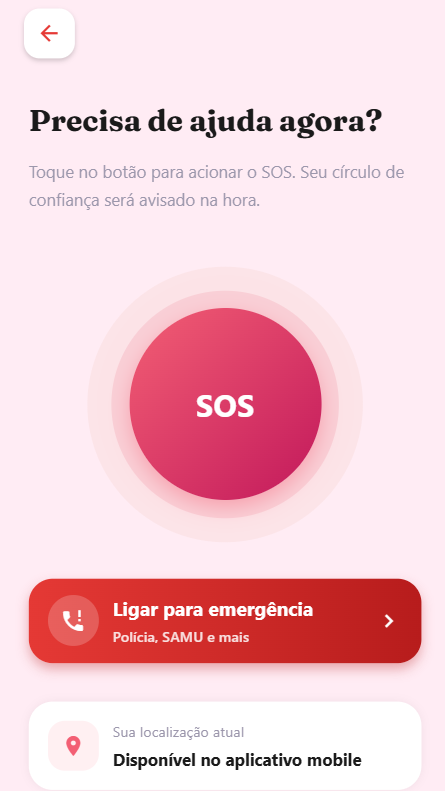

# ElaSegura — Aplicativo de Segurança para Mulheres

O **ElaSegura** é um aplicativo desenvolvido para ajudar na proteção das mulheres. Ele permite acionar um alerta de emergência (SOS), acionar rapidamente os contatos de confiança, registrar ocorrências e acompanhar um mapa colaborativo com as áreas de risco da comunidade. O projeto é uma iniciativa de extensão universitária criada para promover a segurança pessoal por meio da tecnologia.

<p align="center">
  
  
  
</p>

<p align="center">
  <a href="https://ela-segura-bice.vercel.app/"><strong>🔗 Acesse o app</strong></a>
</p>

---

## Funcionalidades

### Proteção
* **Botão de Pânico (SOS)** — Registra o alerta de emergência com a sua localização e reúne seus contatos de confiança para ligar com um toque ou receber a sua posição.
* **Contatos de Emergência** — Cadastre, edite e escolha quais contatos fazem parte do seu círculo de confiança.
* **Números de Emergência** — Central de Atendimento à Mulher (180), Polícia Militar (190), SAMU (192), Bombeiros (193) e Polícia Federal (194) sempre à mão.
* **Chamada Falsa** — Simula uma ligação recebida para ajudar a sair de situações desconfortáveis.
* **Alerta Silencioso** — Registra um SOS com a sua localização sem som e sem nada chamativo na tela, apenas com vibração.
* **Compartilhar Localização** — Envie sua posição atual por qualquer aplicativo de mensagens.

### Comunidade
* **Mapa Colaborativo** — Mapa em tempo real (Leaflet + OpenStreetMap) com ocorrências, áreas marcadas como seguras, de alerta ou de perigo, e pontos de apoio (delegacias, saúde 24h, acolhimento).
* **Registro de Ocorrências** — Cadastre incidentes com título, descrição, tipo e localização, e veja os relatos próximos ordenados por distância.
* **Validação pela Comunidade** — Cada pessoa pode confirmar ou contestar um relato (um voto por pessoa), o que ajuda a separar informação confiável de relatos falsos.
* **Feed de Alertas** — Linha do tempo com os alertas e ocorrências recentes.

### Privacidade e conta
* **Modo Disfarce** — O app pode abrir como uma calculadora comum, que funciona de verdade. Para entrar, basta digitar o seu PIN e tocar em `=`.
* **Autenticação** — Cadastro e login com Firebase Authentication. A recuperação de senha é feita com um código de 6 dígitos enviado por e-mail, com limite de tentativas e validade de 15 minutos.
* **Perfil** — Atualize nome, foto e e-mail (a troca de e-mail é confirmada por um link enviado ao novo endereço).
* **Configurações** — Localização em tempo real, notificações, raio de alerta, senha e modo disfarce.

### Experiência
* **Funciona offline** — As telas abrem com os últimos dados salvos, e SOS e ocorrências criados sem internet são enviados quando a conexão volta.
* **Português e Inglês** — Troca de idioma pelas configurações.
* **Modo Claro e Escuro** — Suporte completo aos dois temas.
* **Acessibilidade** — Rótulos para leitores de tela e retorno tátil (vibração) nas principais ações.
* **Web e Mobile** — Roda no Android, no iOS e no navegador.

---

## Tecnologias

### Aplicativo

| Tecnologia               | Finalidade                                            |
| ------------------------ | ----------------------------------------------------- |
| React Native             | Framework multiplataforma                             |
| Expo (SDK 54)            | Ferramentas de desenvolvimento e módulos nativos      |
| Expo Router              | Navegação baseada em arquivos                         |
| TypeScript               | Tipagem estática                                      |
| Leaflet + OpenStreetMap  | Mapa interativo                                       |
| Expo Location            | GPS e geolocalização                                  |
| Expo Notifications       | Notificações locais                                   |
| AsyncStorage             | Cache offline e preferências locais                   |

### Backend

| Tecnologia                    | Finalidade                                           |
| ----------------------------- | ---------------------------------------------------- |
| Firebase Authentication       | Cadastro, login e sessão                             |
| Cloud Firestore               | Banco de dados em tempo real, com cache offline      |
| Firestore Security Rules      | Regras de acesso e integridade dos dados             |
| Vercel                        | Hospedagem da versão web                             |
| Vercel Functions (`api/`)     | Envio e validação do código de recuperação de senha  |
| Firebase Admin SDK            | Troca de senha no servidor                           |
| Nodemailer                    | Envio dos e-mails com o código                       |

---

## Como Executar

### Requisitos

* **Node.js** versão 18 ou superior
* Um projeto no **Firebase** com Authentication (e-mail/senha) e Firestore ativados
* Aplicativo **Expo Go** no celular (Android ou iOS), ou um navegador para a versão web

### Passo 1 — Instalar as dependências

```bash
cd ElaSegura
npm install
```

### Passo 2 — Configurar as variáveis de ambiente

Copie o arquivo de exemplo:

```bash
cp .env.example .env
```

Preencha as variáveis `EXPO_PUBLIC_FIREBASE_*` com os dados do seu projeto (Console do Firebase → Configurações do projeto → Seus apps → Configuração do SDK).

> **Observação:** As variáveis do servidor (`FIREBASE_PRIVATE_KEY`, `SMTP_*`, `RESET_CODE_SECRET`) são usadas apenas pela recuperação de senha e devem ser configuradas **somente no painel da Vercel**, nunca no código.

### Passo 3 — Publicar as regras do Firestore

```bash
npx firebase-tools login
npx firebase-tools deploy --only firestore:rules
```

### Passo 4 — Iniciar o aplicativo

```bash
npm start
```

Escaneie o QR Code com o **Expo Go** ou pressione:

* `w` para abrir no navegador;
* `a` para abrir no emulador Android;
* `i` para abrir no simulador iOS.

> **Observação:** A recuperação de senha por código depende das funções da pasta `api/`, que rodam na Vercel. Para testá-la no computador, use `vercel dev` em vez de `npm start`.

---
